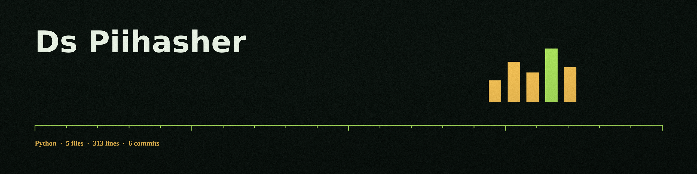

# ds-PIIHasher
A command-line tool that detects Personally Identifiable Information (PII) with presidio_analyzer and then hashes it or replaces it with synthetic data, in CSV, JSON, and text files.

## Install
`git clone https://github.com/ShadowStrikeHQ/ds-piihasher`

## Usage
`./ds-piihasher [params]`

## Parameters
- `--file_type`: No description provided
- `--fields`: No description provided
- `--pii_types`: No description provided
- `--hash`: Hash PII with bcrypt. Salted, one way, and not consistent: the same value gives a different hash on each occurrence.
- `--keyed-hash`: Hash PII with a keyed HMAC-SHA256 hash. Consistent for anyone holding the key: the same value gives the same output. One way and not reversible.
- `--hash-key`: Key for --keyed-hash. If not given, the DS_PIIHASHER_KEY environment variable is used.
- `--replace`: Enable PII replacement with synthetic data.
- `--seed`: Seed for the Faker instance, so a --replace run with the same seed produces the same synthetic data.

## License
Copyright (c) ShadowStrikeHQ

## Modes and notes
- A mode must be chosen: pass one of --hash, --keyed-hash, or --replace. A run with no mode, or with more than one mode, is refused at exit 1 and writes no output.
- No hash mode is reversible. Reversibility is not offered by this tool: hashing is one way, and the earlier wording that called the bcrypt hashes consistent and reversible was wrong and has been removed.
- The output file must not be the input file. A run that names the input as the output is refused at exit 1 before any file is written.
- Every error path exits 1, including a missing, unreadable, or unparseable input.
- Detections below the 0.8 score threshold are logged with their type and score and are left unprocessed. Every run prints a count of values left unprocessed. JSON processing visits nested objects and strings inside lists.
